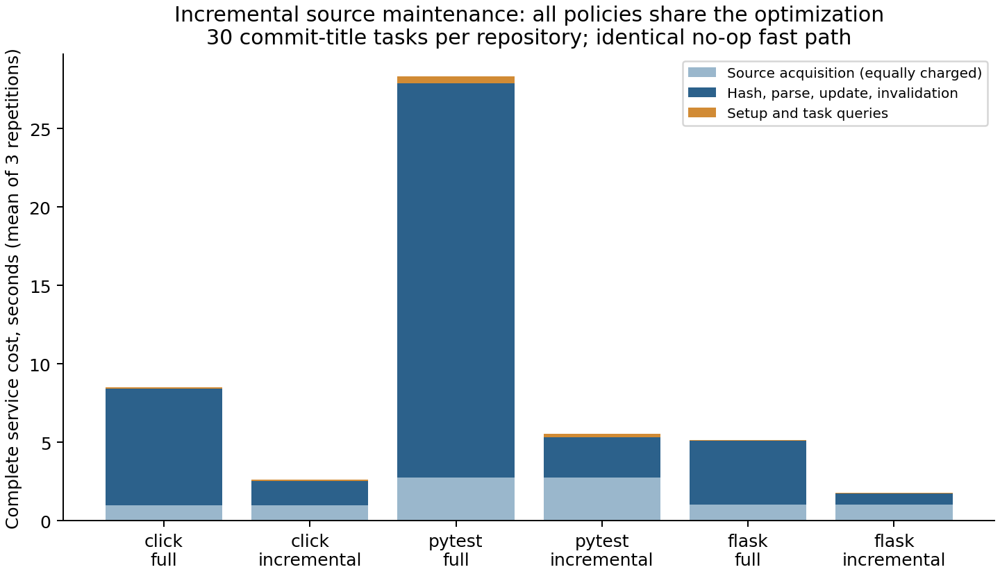
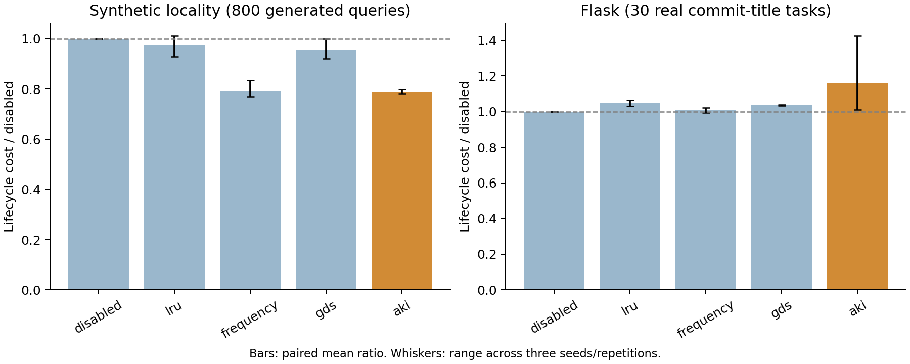
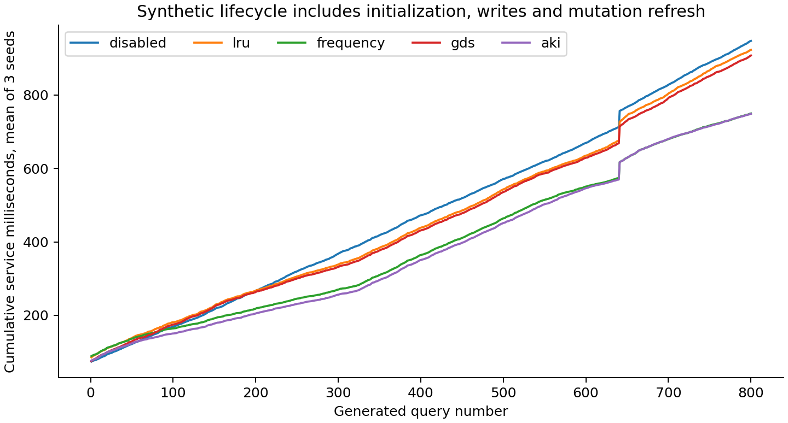

# Phase two: diagnosis-driven experiments

This follow-up preserves the [phase-one negative result](RESULTS.md). It tests
the [preregistered hypotheses](PHASE2_PROTOCOL.md), fixes reproduced state and
freshness bugs, and broadens evaluation to actual historical task titles and
previously unused ARB repositories. No novelty or agent-repair claim is made.

**Measured milestone:** common incremental maintenance passes the registered 40%
savings criterion, including the Flask holdout. AKI admission does not beat the
strongest simple cache by 20%. Free reuse of every still-valid repeated closure
could save less than 0.34% on these task-derived history sequences. The selective
gate also fails. These are distinct findings, not a breakthrough claim.

## Protocol and version boundaries

The protocol was committed as `f2de1ca` before implementation. Engine/harness
changes are in `76316b7`; the Python physical-line evidence correction is in
`9929b57`. Primary lifecycle runs use `5bd8417`, with exact source hashes in each
provenance file. The gate and official lexical ranking code were frozen before
development scoring; those files are unchanged across the subsequent engine
line-accounting fix. Each run records its actual imported source version.

Release commit `80085ac` adds extractor-version checks and byte-exact CRLF/CR
loading. Primary timings remain measurements of `5bd8417`; they are not relabeled
as final-patch timings. The final patch passes 28 tests, a separate 70-query /
420-operator smoke comparison across all 35 conditions, and the real-history
source-evidence audits. Its new guards concern old/uninitialized stores; primary
runs use fresh stores and their Git-archive loader already preserves exact bytes.

Every condition receives identical source and retrieval semantics, a common
same-tree no-op path, and the same materialization budget. Each owns a fresh
durable SQLite database. Conditions are shuffled/interleaved at setup, every
refresh, and every task/query; runs execute serially. A separate/batched-write
ablation is applied to all policies. Full static materialization remains an
explicitly unbounded reference; static bounded uses the matched budget.

Synthetic experiments use new seeds 70–72, 64 KiB and the existing frozen policy
parameters. Locality has 800 queries per seed; the control has 500 distinct
anchors per seed. Cold adaptation, frozen new queries, unseen anchors, drift
and mutation remain separately labeled. These are generated workloads.

Click, pytest and Flask each supply 30 actual first-parent commit-title tasks,
queried on the task commit's **parent** source tree. Routing uses only title
text and current paths/symbols/FTS; it never receives changed-file targets,
future tasks or gold. Each title is processed once per timing repetition; no
target-conditioned warm-up or artificial repeated tasks are inserted. These
are **task-derived requests, not observed agent trajectories**. Three repetitions
share the same real task sequence; they are not 90 independent tasks per repo.
Commit titles are written after a change and may name its solution; they are
not recorded pre-fix issue prompts. Using parent source avoids future-code
access, but does not remove this post-hoc query-construction limitation.
Budgets are 16 KiB. Both base-update modes and both invalidation modes are run.

Complete service cost includes database/policy construction, locally acquiring
the Git source snapshot, source hashing, parse/resolve, indexing, invalidation,
static construction, routing, retrieval, optimizer, writes and eviction. Shared
snapshot-acquisition time is measured once per event and charged equally.
Correctness oracles, generation of the benchmark sequence and raw-result output
are outside the service timer. Initial public downloads are setup prerequisites,
not included in online service totals. No background work, GPU or inference API
is used. Costs are wall time, not CPU usage or dollar estimates. OS caches were
not flushed and this was a shared Mac, so small timing differences are noisy.

Hardware: Apple Mac14,10 arm64, 12 logical CPUs, 32 GiB RAM; Python 3.11.5 and
SQLite 3.42.0. Per-run OS/code/clock provenance and hardware-source details are
in `results/phase2`. No CPU-time or energy measurement is claimed.

## Common maintenance: registered criterion passed

Disabled adaptation isolates the shared base mechanism below. Both conditions
use selective invalidation, hash complete inputs, skip identical snapshots and
include source acquisition.

| 30 task-derived events | Full refresh, mean seconds | Incremental, mean seconds | Mean paired reduction (range over 3 repetitions) |
|---|---:|---:|---:|
| Click, development | 8.497 | 2.621 | 69.14% (68.33–70.37%) |
| pytest, development | 28.322 | 5.530 | 80.39% (79.34–82.10%) |
| Flask, held-out repository | 5.143 | 1.787 | 65.25% (64.97–65.70%) |

Paired percentage averages differ slightly from percentages of overall means.
Ranges are descriptive repetitions, not confidence intervals from independent
tasks. This engineering gain is shared by every policy; it does not establish
a new admission algorithm.



Allocated database size falls from 35.86 to 8.18 MiB on Click, 118.46 to 16.80 MiB
on pytest, and 22.39 to 4.34 MiB on Flask. This full-refresh implementation copies
unchanged historical spans under new revisions; incremental refresh reuses them.
This is not a storage lower bound for every possible full-refresh design.
Historical storage still grows. Logical cache budgets and physical pages remain
separate measurements.

## Admission: registered advantage criterion failed

Mean complete service milliseconds under incremental maintenance and selective
invalidation; all bounded policies share their budget. Full static is an
explicitly unbounded reference. Every repetition and outlier is retained.

| Sequence | Disabled | Static bounded | Static full (unbounded) | LRU | Frequency | GDS | AKI |
|---|---:|---:|---:|---:|---:|---:|---:|
| Synthetic locality | 947.01 | 2720.13 | 3867.92 | 922.62 | 749.49 | 907.33 | 748.61 |
| Synthetic low reuse | 624.38 | 2394.27 | 3543.37 | 849.39 | 650.18 | 848.76 | 635.72 |
| Click | 2621.35 | 2864.16 | 2848.42 | 2705.58 | 2590.84 | 2681.61 | 2644.51 |
| pytest | 5529.61 | 7190.31 | 7019.43 | 5655.45 | 5590.46 | 5616.57 | 5623.22 |
| Flask | 1787.47 | 2035.70 | 2049.50 | 1873.31 | 1804.37 | 1852.16 | 2074.29 |

Frequency is the strongest simple demand cache by mean lifecycle cost in each
sequence. Synthetic paired AKI/frequency ratios are 1.037, 1.014 and 0.946; their
mean is 0.999, far from the 0.8 criterion. Low-reuse AKI is 1.8% slower than
disabled adaptation and has no valid repeated candidates.

Flask's AKI mean contains a cold-refresh spike in repetition 71: **920.34 ms**,
versus 156.17 ms frequency and 149.78 ms disabled. It occurs before the first
admission; 408.83 ms is parse/resolve and 508.06 ms storage update. The cause is
unestablished. The observed 14.8% mean paired AKI/frequency excess is not proof
of an inherent admission-algorithm slowdown. Randomization did not eliminate
shared-host variability.



Batched/separate durable-write lifecycle milliseconds on synthetic locality are
LRU 922.62/1014.12, frequency 749.49/757.65, GDS 907.33/1034.67 and AKI
748.61/784.59. The common storage improvement helps all four policies and is
not credited solely to AKI.

The free-cache audit assumes unlimited admission and free reads, writes and
validation. It invalidates affected cached closures and checks retained ones
against fresh independent BFS. This is a diagnostic ceiling, not an achieved
policy or a free-cost claim.

| Sequence | Valid repeats / requests, per repetition | Free valid-repeat savings ceiling | Free all-traversal ceiling |
|---|---:|---:|---:|
| Click | 97 / 180 | 0.232% | 0.460% |
| pytest | 103 / 180 | 0.339% | 0.701% |
| Flask | 67 / 144 | 0.323% | 0.734% |
| Synthetic locality | 534–547 / 800 | 39.810% | 58.784% |
| Synthetic low reuse | 0 / 500 | 0% | 56.139% |

Reuse exists in the task-derived sequences, but the reusable closures are too
cheap to meet a 20% service-cost goal. Six Flask titles route to no relationship
operations; they remain in accounting. Under the registered stop rule, further
admission search on this operator family is not justified by these workloads.
Actual agent access patterns may differ; this is not a universal bound.

## Latency and observed break-even

Query-only p50/p95 milliseconds (lower empirical quantiles, averaged across
three runs) are synthetic disabled 0.963/2.279, frequency 0.625/2.085 and AKI
0.608/2.040. On Flask they are 1.275/2.212, 1.500/3.002 and 1.375/2.643.
Including acquisition and refresh, Flask task p50/p95 is 51.57/93.34 ms disabled,
52.24/93.21 frequency and 53.31/95.98 AKI. Raw records contain every latency.



Sustained observed break-even against disabled on synthetic locality is at
queries 83/1/60 for AKI and 41/64/163 for frequency. No AKI low-reuse or Flask
repetition breaks even. These crossings include all measured startup costs:
query-1 crossings can reflect ingestion noise before adaptation. They are
realized traces, not stable causal amortization thresholds. `analysis.json`
reports every condition, repetition and temporal metric.

## Selective retrieval: registered criterion failed

The opt-in gate admits an explicit current path, unique basename or unambiguous
released symbol hint. Otherwise it returns `insufficient_evidence`. The symbol
metadata are heuristic extraction, not proof of semantic declarations. No gold
score threshold is fitted. The underlying official lexical ranker is unchanged.

| Exposed development, 101 positives / 82 negatives | Lexical | With gate |
|---|---:|---:|
| MRR | 0.20745 | 0.15762 |
| Recall@20 | 0.69637 | 0.51650 |
| Canonical BCY@8k | 0.37954 | 0.31683 |
| Natural no-gold correct abstention, n=50 | 0% | 0% |
| Wrong-repository correct abstention, n=32 | 0% | 12.5% |

This misses both the 20% natural-abstention target and the maximum five-point
recall-loss criterion. The rule was not subsequently tuned and remains
experimental/opt-in. All 101 ungated positive rankings and canonical scores
match the prior official lexical run exactly.

Only 27 development positives are Python; 74 are other languages. The gate
admits all 27 Python positives, so their Recall@20 stays 0.52469. Other-language
Recall@20 falls from 0.75901 to 0.51351. The Python-only relationship extractor
cannot support claims about graph reuse in the other-language examples.

The untouched retrieval partition comprises 29 code2test positives in five
preselected repositories (18 Python, 11 other languages; 28 snapshots). The
same gate admits every query, giving identical lexical ranks: MRR **0.11113**,
Recall@20 **0.30460**, canonical BCY@8k **0.18966**. This is a no-change result,
not evidence that the gate solved abstention. No untouched natural-negative
set was available. Per-repository metrics and all rankings are published.

## Correctness and scope

The release suite passes 28 tests, including the two reproduced cache-state bugs,
common no-op behavior for every policy/base mode, full/incremental equivalence,
new modules resolving unchanged imports, file moves/deletions, content-budget
refresh, multiline imports, Unicode physical lines, scope/revision rejection
and 80 generated mutation episodes. Every timed retrieval is checked against
fresh independent BFS/packing using the same deterministic extractor. Raw answer
hashes additionally bind returned paths to current file-content hashes.

Independent raw accounting and answer-hash checks pass for **53,550 primary
query-condition rows and 97,020 relationship operations**. The separate release
smoke adds 70 rows / 420 operations and is not used for performance conclusions.
An additional final-patch audit checks 90 real source snapshots, **68,833 active
span instances and 120,915 evidence links**, with exact source/hash membership,
fresh-parse edge equivalence and stale-revision rejection. All pass; these full
source snapshots have zero parser errors. Counts include repeated unchanged
spans across snapshots, not that many unique source regions.

These checks establish parity within the implemented import-graph semantics,
not complete code understanding, verified task evidence, repair success or a
universal freshness guarantee. Clients must refresh a complete source snapshot
before querying after edits. Dynamic imports, dispatch, configuration edges and
non-Python relationship extraction remain unsupported. Historical spans have
no garbage collector, and materialization byte budgets do not bound total RAM
or source-archive disk. A new Policy intentionally discards persisted derived
rows; resumable persisted cost/history state is not implemented.

## Reproduction

Clone the public sources pinned in [DATA_SOURCES.md](DATA_SOURCES.md), including
Flask. Obtain the additional corpus outside the project:

```sh
python3 scripts/prepare_arb.py --out ../arb-code2test --subsets v2_code2test
```

On the tested Mac, Python needed the existing system trust store:
`SSL_CERT_FILE=/etc/ssl/cert.pem` prefixed that command. TLS verification stayed
enabled. No installation or new credential is required.

```sh
sh scripts/reproduce_phase2.sh results/my-phase2
python3 scripts/verify_release.py
python3 scripts/plot_phase2.py --root results/phase2
```

The reproduction script refuses existing output directories. The checked-in
results use the directory names listed in `results/phase2/analysis.json`.
Plotting is optional and uses already installed matplotlib; engine and scoring
need only Python/SQLite and the pinned, inspected benchmark checkout.
`verify_release.py` checks the checked-in release fingerprints; run it before
regenerating figures, whose SVG metadata can change between renderings.
