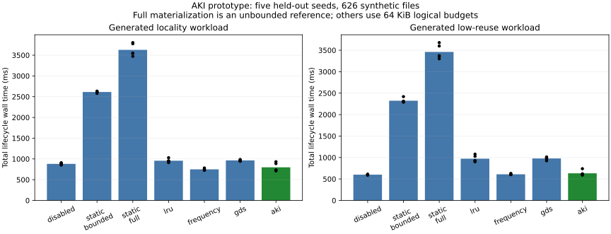
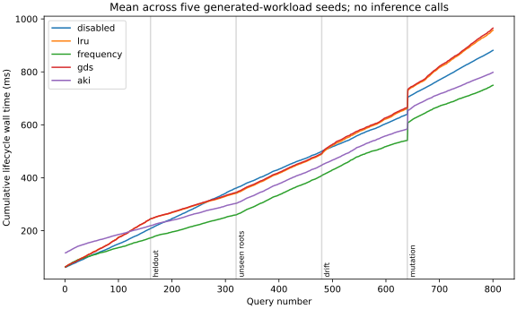

# First research milestone: no distinctive optimizer win

Measured on 2026-10-25. AKI has a working, revision-safe prototype and a
reproducible evaluation harness. **The experiments do not establish an advantage
over the strongest simple baseline or a retrieval-quality improvement.** They
identify where reuse helps, where its overhead loses, and which safety properties
the prototype can test. This is a negative/diagnostic result, not a breakthrough.

## 1. Confirmatory generated workload

626 original synthetic Python files, 2,727 parsed import edges, 800 queries per
seed, five previously unused seeds (50–54). Policies have 65,536 logical bytes
for materializations; static full is an explicitly unbounded reference. The
same extractor, query semantics and token budgets apply to all policies.
Queries are generated and are not coding-agent tasks or success outcomes.

| Policy | Mean service lifecycle, ms | Mean query+policy work, ms | Mean peak materialized bytes |
|---|---:|---:|---:|
| Disabled | 881.20 | 756.95 | 0 |
| Static bounded | 2,612.40 | 797.34 | 65,530 |
| Static full, unbounded | 3,628.64 | 280.34 | 6,273,237 |
| LRU closures | 957.21 | 829.04 | 65,504 |
| Rolling frequency | **749.32** | 621.65 | 65,450 |
| GDS-style | 965.07 | 837.05 | 65,492 |
| AKI | 798.17 | **615.01** | 65,016 |

AKI's ratio of mean lifecycle costs is 0.906 versus disabled, but 1.065 versus
frequency. Mean paired AKI/frequency ratio is 1.0645; a descriptive seed-bootstrap
95% interval is [0.9705, 1.1585]. Five query seeds on one synthetic graph and one
shared Mac do not support a population-level performance guarantee. The
20%-better-than-strongest-baseline project target is not met.

All 28,000 query outputs matched the independent BFS/packing oracle exactly.
This establishes equivalence to the implemented static graph semantics; it does
not establish true runtime dependency completeness or task correctness.

AKI's mean initial ingestion time was 115.70 ms versus 62.95 ms for frequency;
two AKI startup outliers (229.91 and 168.88 ms) were retained. Query+policy work
alone was only about 1.1% faster than frequency. Removing shared ingestion work
would not establish a practically large optimizer benefit. The results are
sensitive to background load and filesystem timings, so the report neither
discards those observations nor interprets the slowdown as a clean causal
algorithm effect.

## 2. Cold, warm, unseen, drift and break-even

The five phases each contain 160 queries. After adaptation, state is frozen for
new query strings drawn from the same locality distribution, then for anchors
in a disjoint source partition. Adaptation resumes for a workload switch and
again after a controlled source mutation. No gold label or future query enters
policy state. Whole-file token packing uses the prototype's documented regex
proxy; these timings are not ARB token metrics.

Below are the mean of per-seed p50/p95 query latencies in milliseconds. Query
latency includes optimizer, construction and eviction when they occur. Initial
ingestion and refresh are included in lifecycle totals rather than hidden in
these quantiles.

| Phase | Disabled p50 / p95 | Frequency p50 / p95 | AKI p50 / p95 | AKI hit rate |
|---|---:|---:|---:|---:|
| Cold adaptation | 0.799 / 2.047 | 0.401 / 2.002 | 0.385 / 1.879 | 51.5% |
| Warm, frozen new queries | 0.922 / 2.095 | 0.297 / 1.504 | 0.308 / 1.441 | 64.4% |
| Unseen anchors, frozen | 0.777 / 2.054 | 0.835 / 2.149 | 0.817 / 2.095 | 0% |
| Workload drift | 0.832 / 1.842 | 0.586 / 2.447 | 0.666 / 2.215 | 19.8% |
| After source mutation | 1.136 / 1.848 | 0.663 / 2.221 | 0.740 / 2.009 | 44.9% |

AKI's sustained cumulative break-even versus paired disabled runs occurs at
queries 1, never, 29, 32, never for seeds 50–54. The query-1 crossing is a timing
artifact of independently measured startup costs, not evidence of immediate
amortization. Frequency reaches sustained break-even at 64, 79, 1, 48, 75.
All cumulative curves charge startup and mutation refresh. A floating-point
cancellation issue in the derived break-even calculation was corrected using
paired subtraction; raw timings were unchanged.

The zero-reuse control uses 500 queries per seed and five seeds 40–44. There
are no repeated anchors and no cache hits. Mean lifecycle costs: disabled
600.59 ms, frequency 609.61 ms, AKI 632.75 ms, LRU 972.32 ms, GDS 978.62 ms.
AKI's mean paired ratio to disabled is 1.0531 (descriptive bootstrap interval
[1.0038, 1.1363]). All 17,500 outputs match. Adaptation has measurable downside.

## 3. Real repository history, generated queries

Click uses eight actual first-parent revisions and 120 generated requests per
revision. pytest uses six revisions and 80 requests per revision. Both have
three seeds, 16 KiB materialization budgets, all seven policies, and global vs
selective invalidation. Snapshots arrive in chronological order; policies see
only the current source snapshot and past requests. The requests are generated,
not real agent traces or recovered human development tasks.

Mean service lifecycle milliseconds per complete history:

| Policy | Click global | Click selective | pytest global | pytest selective |
|---|---:|---:|---:|---:|
| Disabled | **2,267.05** | **2,302.73** | **6,096.19** | **6,063.39** |
| Static bounded | 2,495.56 | 2,365.91 | 6,773.05 | 6,704.42 |
| Static full, unbounded | 3,992.04 | 2,399.38 | 8,419.84 | 6,719.27 |
| LRU | 2,938.72 | 3,045.11 | 6,621.47 | 6,873.90 |
| Frequency | 2,464.41 | 2,461.52 | 6,184.20 | 6,198.94 |
| GDS-style | 2,866.11 | 2,930.93 | 8,094.68 | 6,641.46 |
| AKI | 2,291.39 | 2,330.87 | 7,146.76 | 6,161.74 |

There were 40,320 correct Click outputs and 20,160 correct pytest outputs, with
zero stale-revision acceptances in the explicit stale-request checks. The Click
source tree changes on four transitions; pytest changes on two. Documentation-
only commits are retained rather than removed to favor the experiment.

Selective invalidation preserved 3,375 full-materialization entries across the
Click runs and 7,458 across pytest runs, while invalidating 153 and 762,
respectively. It cuts the full prebuild reference's mean lifecycle cost by about
39.9% on Click and 20.2% on pytest. **Disabled adaptation still wins overall.**
These figures establish useful avoidance of unnecessary work under the chosen
extractor, not a new state-of-the-art retrieval layer. Histories are small and
adjacent; broad repository-generalization remains untested.

## 4. ARB: real static tasks, retrieval only

Evaluated all **101 trace2code positives** and **82 no-gold cases** using released
`all_files` corpora, no keep list, and evaluator commit
`2c773139dd86003ec6defffa28bff1688c4af768`. These are subsets of ARB, not the full
427-sample benchmark. Quality was not used to tune the prototype. ARB's canonical
BCY tokenization and partial-prefix rule are used; legacy character-counted
coverage is excluded.

| Method | MRR | Recall@20 | BCY@4k | BCY@8k | BCY@16k | BCY@32k |
|---|---:|---:|---:|---:|---:|---:|
| Official Lexical, freshly run | 0.2075 | 0.6964 | 0.1749 | 0.3795 | 0.5561 | 0.6865 |
| Official BM25, freshly run | 0.1638 | 0.4934 | 0.1205 | 0.1931 | 0.3069 | 0.4934 |
| Official RepoMap, freshly run | 0.2723 | 0.8465 | 0.2360 | 0.5066 | 0.7046 | 0.8366 |
| Prototype FTS | 0.1568 | 0.4191 | 0.1337 | 0.2162 | 0.3020 | 0.4092 |
| Prototype FTS + import closures | 0.1618 | 0.4653 | 0.1337 | 0.2162 | 0.3300 | 0.4554 |
| Oko 0.9.1 run 1, **offline rescore only** | 0.7383 | 0.8927 | 0.7228 | 0.8152 | 0.8729 | 0.8927 |

The prototype's graph ranking is exactly identical with disabled, LRU and AKI
storage. The recorded initial ARB version makes 145 closure requests and
observes zero materialization hits. That version does not cache empty closures;
later demand-cache baselines do. These static samples do not establish a useful
recurrent workload for this materialization family.

All four prototype methods return rankings on all 50 natural no-gold and all 32
counterfactual cases: **0% correct abstention in each stratum**. There is no
calibrated no-gold classifier. A physical cache miss must not be interpreted as
“no useful repository context.” The official positive baselines were not run as
a full selective comparison. One negative sharing a positive snapshot appears
in their raw output; it is not used as a selective-performance claim.

As an independent harness check, the unmodified official
`evaluate_lexical_baseline` entrypoint was also executed on all 101 positives.
All top-20 lists, MRR and Recall@20 values matched our adapter exactly, with
zero skipped samples (`results/arb-v1/official_crosscheck.json`).

Per-repository macro MRR is 0.0870 for the graph prototype, 0.1948 for Lexical,
0.1712 for BM25 and 0.3688 for RepoMap. Full per-repository summaries and per-sample
rankings are published. No confidence interval treating all same-repository
samples as independent is claimed. There is no patch-success or sufficient-span
coverage result. BCY counts exposure to gold files, not verified evidence use.

Oko's ranking checksum was verified, and its stored MRR/Recall values matched
fresh offline scoring. We did not generate its rankings, reproduce API cost or
runtime, or call its paid reranker. Its nominal held-out half was exposed during
development regression checks, as disclosed upstream. Its score is a useful
strong reference, not a clean causal head-to-head.

## 5. Verification and provenance

The final standard-library test suite has **16 passing tests**. It includes
cycles, scope/revision rejection, immutable spans, import-span hashes, UTF-8
integrity, frozen policy state, byte budgets, disjoint unseen anchors and mutation
properties. The 80-mutation property test compares cached results against freshly
recomputed graphs, covering additions, changed edges, deletions, renames and new
incoming dependencies. This finite suite is not a universal safety proof.

`scripts/verify_results.py` independently rechecks raw accounting identities,
byte budgets and cross-policy result hashes without importing the engine. It
audits **166,780 generated-workload/history query measurements** across all
exploratory and final runs, plus 183 ARB ranking-parity cases. The primary final
experiments account for 105,980 of those queries. History raw events record the
BFS assertions but not answer hashes; that weaker post-hoc auditability is
explicit in `results/verification.json`.

| Run directory | Role | Code provenance |
|---|---|---|
| `pilot-v1` | Initial two-seed diagnostic | Pre-Git source hashes; not an exact-checkout reproduction target |
| `synthetic-v2` | Five-seed exploratory development | Pre-Git source hashes; not an exact-checkout reproduction target |
| `final-synthetic` | Preserved run with insufficient unseen-anchor separation | `927d03c`; superseded by final-synthetic-v2 |
| `final-low-reuse` | Primary zero-reuse control | `927d03c`; zero-reuse generator unchanged by partition fix |
| `final-synthetic-v2` | Primary confirmatory locality experiment | `3569710` |
| `click-history` | Primary real-source history, generated requests | `927d03c` and recorded source hashes |
| `pytest-history` | Primary second real-source history | `3569710` and recorded source hashes |
| `arb-v1` | Static real-task retrieval gate | First implementation `f325d4c` / recorded source hashes |
| `oko-trace2code-rescore.json` | Offline reference rescore | Pinned third-party ranking SHA-256 and official evaluator |

Derived break-even fields were recalculated with the correction in `824b491`.
All raw timings remain unchanged. Use each run's `provenance.json` for complete
source hashes, dataset identity and parameters. Source acquisition pins and
licenses are in [DATA_SOURCES.md](DATA_SOURCES.md).

Hardware: Apple Mac14,10 arm64, 12 logical CPUs, 32 GiB RAM, Darwin 25.6.0,
Python 3.11.5, SQLite 3.42.0, FTS5 enabled. `perf_counter_ns` measures elapsed
wall time. Cold means fresh SQLite databases and empty application caches, not
flushed OS caches. Condition order is seeded and shuffled; other applications
on the Mac are not isolated. The experiments made **zero model-inference API
calls**, and no compute or data was purchased. CPU energy and whole-process
peak RAM were not measured.

“Service lifecycle” begins with a provided immutable text snapshot. It includes
hashing, parsing, SQLite/FTS population, candidate generation, reads, optimizer
work, construction, eviction, validation and refresh. Fixture generation,
Git-based source acquisition, oracle computation and result serialization are
outside that boundary. ARB additionally records corpus file-load timing.
No background policy work exists. This is not end-to-end agent latency or cost.

Logical storage budgets exclude the canonical base and immutable archive.
For the confirmatory synthetic run, final allocated SQLite size averages about
2.02 MiB disabled and 2.08 MiB AKI; static full has a much larger materialization
inventory. Per-run allocated/live pages and logical bytes are retained. A hard
whole-process storage/RAM quota is not implemented.

## 6. What the evidence supports next

The materialization mechanism and freshness checks work under their explicit
snapshot/extractor contract. The selected cost heuristic does not beat strong
frequency admission reliably. On these real histories, graph work is too cheap
and refresh dominates; on ARB there is little demonstrated applicable reuse.
Generic “knowledge improves with use” novelty is already covered by prior art.

The next useful experiment needs a **public, chronological sequence of actual
coding retrieval requests** and a measured reuse-opportunity analysis. That
would distinguish a poor policy from an unsuitable candidate family. Then test
incremental base refresh and candidates for larger repeated cross-file joins,
using the same strong caches and an independently held-out repository split.
Require at least 20% lower full service cost than the strongest matched policy,
identical retrieval output, and no stale evidence before paying for a repair-agent
experiment. No additional spending is justified by the present measurements.
